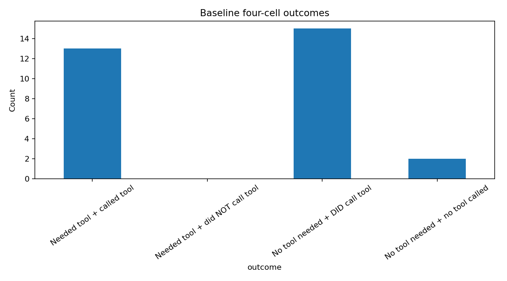
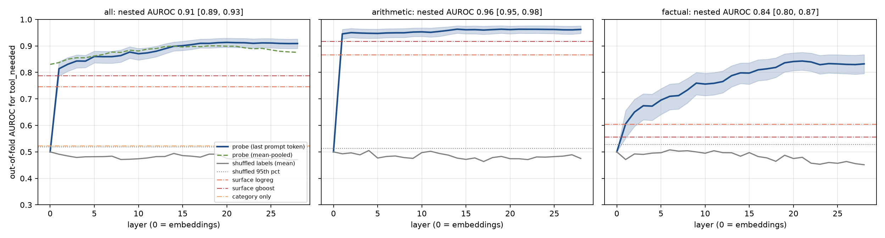
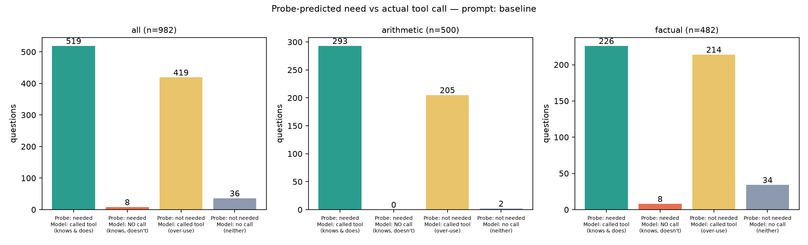
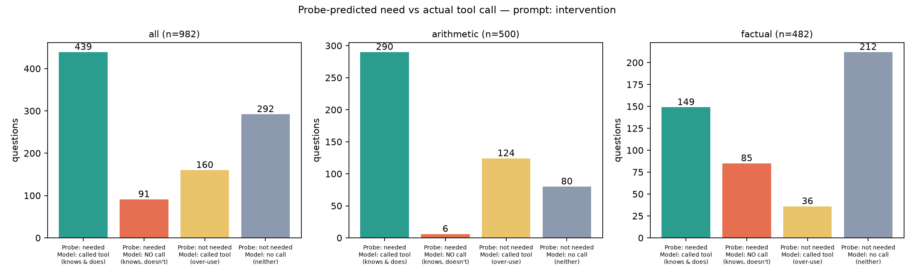
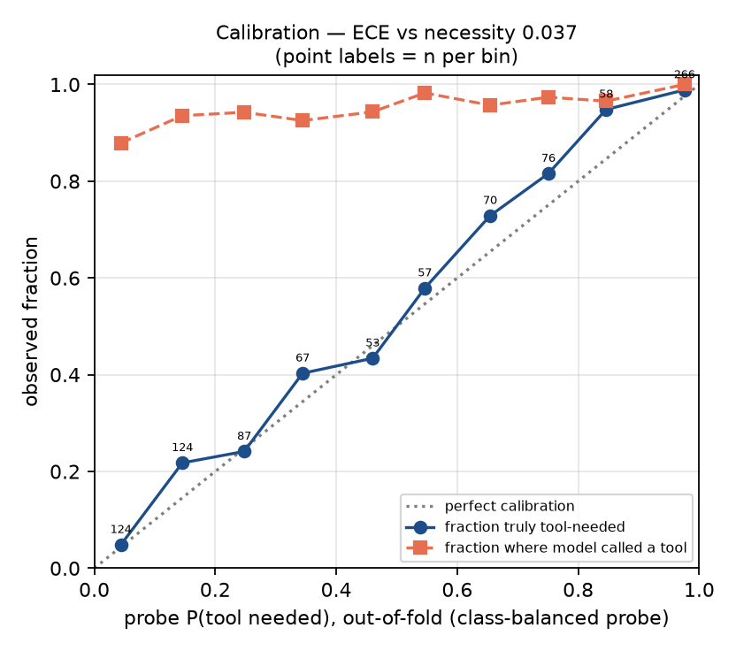

# The Knowing-Doing Gap: Does an LLM Know It Needs a Tool?

An experiment measuring the gap between what an LLM *believes* about its own capability and what it *does* when tools are available. It has two parts, both adaptations of the paper's tool-necessity setup on Qwen2.5-7B-Instruct:

1. **Behavioral experiment** (30 questions, black-box through TogetherAI): does the model call a tool when it needs one, and only then?
2. **Hidden-state probe extension** (1,000 questions, local bf16 run with access to activations): does the model's internal representation encode "this question needs a tool", and does its behavior follow it? See [Hidden-state probe (extension)](#hidden-state-probe-extension).

Based on: Cheng, Fan, JafariRaviz, Rezaei, Feizi — ["Model-Adaptive Tool Necessity Reveals the Knowing-Doing Gap in LLM Tool Use"](https://arxiv.org/abs/2605.14038), 2026.

The experiment tests whether an LLM with access to tools can decide when to answer from memory and when to call a tool. It separates three signals for each question:

1. **Model-adaptive tool necessity**: whether Qwen2.5 can answer the question reliably without tools across repeated no-tool runs.
2. **Cognition**: whether the model reports low confidence answering without a tool.
3. **Action**: whether the model actually calls a calculator or search tool in an agentic setting.

Each question is mapped into one of four cells:

| Necessity      | Action            | Interpretation                    |
| -------------- | ----------------- | --------------------------------- |
| Needed tool    | Called tool       | Aligned behavior                  |
| No tool needed | Did not call tool | Aligned behavior                  |
| Needed tool    | Did not call tool | Tool underuse / knowing-doing gap |
| No tool needed | Called tool       | Tool over-reliance                |

## Results at a glance

**Behavioral experiment** (30 questions, TogetherAI):

| Metric                         | Baseline | Intervention |
| ------------------------------ | -------: | ------------: |
| Tool call rate                 |    93.3% |         56.7% |
| Necessity-action mismatch rate |    50.0% |         26.7% |
| Action accuracy                |    93.3% |         83.3% |

Qwen2.5-7B-Instruct calls a tool on 28 of 30 questions — including most of the ones it can already answer correctly on its own. Here the model **over-relies** on tools it doesn't need. The paper reports both directions, depending on model and domain: its Llama models and Qwen3-4B under-use tools on arithmetic, while Qwen3-8B over-uses them there (38.2% unnecessary calls vs 3.5% missed calls, paper Table 1). A rewritten system prompt (`INTERVENTION_SYSTEM` in [`src/run_action.py`](src/run_action.py), which says to answer simple or well-known questions directly and use a tool for hard, recent, obscure or uncertain ones) nearly halves the mismatch rate, at the cost of two questions flipping into true tool-underuse. See [`results/summary_metrics.csv`](results/summary_metrics.csv) and the figures below for the full breakdown.

<p>
  
  
</p>

**Hidden-state probe** (1,000 questions run locally in bf16; 982 analysed after correcting labels; every number is from [`results/probe_corrected/`](results/probe_corrected/)):

| | Result |
|---|---|
| Linear probe on the last prompt token, predicting tool necessity (nested CV AUROC, 95% CI) | 0.910 [0.891, 0.927]; shuffled labels 0.471; best surface-feature baseline 0.788; averaged input embeddings 0.830 |
| Factual questions only | 0.839 [0.804, 0.872]; averaged input embeddings 0.657 |
| Arithmetic questions only | 0.963 [0.948, 0.976]; averaged input embeddings 0.936 |
| Tool-call rate, baseline prompt → intervention prompt | 95.5% → 61.0% (339 questions stopped calling, none started) |
| Same probe, frozen, scored on the other prompt | 0.896 (trained on baseline), 0.903 (trained on intervention) |

In short: whether a tool is needed is linearly decodable from the model's hidden state, clearly beyond the words themselves on factual questions and only slightly on arithmetic. The signal carries over between prompts while tool-calling changes a lot, and the calls that the intervention prompt removes are mostly on low-need questions. A probe shows what is decodable, not what the model uses. See the [full results and caveats](#results).

<p>
  
</p>

## How this differs from the paper

- **Behavioral experiment: black-box only.** It measures behavior through the API (repeated no-tool runs, self-reported confidence, actual tool calls) and does no hidden-state probing.
- **Hidden-state extension: a partial adaptation.** It trains necessity and action probes on a locally run model and compares their directions at the last prompt token, adding a noise ceiling. It does **not** sweep token positions or reproduce the per-sample stage attribution, and its model, data, prompts and tool protocol differ, so it neither confirms nor refutes the paper's orthogonality result. See [what is replicated, adapted, and new](#what-is-replicated-adapted-and-new).
- **One model, small question sets.** 30 questions (behavioral) and 1,000 questions (probe extension) on a single model, versus the paper's larger multi-model study.
- **Own intervention.** The rewritten system prompt is my addition, not part of the original paper. It changes several instructions at once, so the effect cannot be pinned on any single line.

## Repository structure

```text
knowing-doing-gap/
  data/
    questions.json          # 30 curated questions: 15 arithmetic + 15 factual QA
    questions_probe.json    # Probe extension: 1,000 questions (the 30 above + generated arithmetic + TriviaQA)
    accept_lists_v2.json    # Probe extension: rebuilt accepted aliases
    label_decisions.json    # Probe extension: reviewed label decisions, with reasons
    mock_search.json        # Mock search results for factual questions
  deliverables/
    question_set.xlsx       # Human-readable question-set table
  src/
    model_client.py         # TogetherAI OpenAI-compatible client
    label_necessity.py      # Repeated no-tool runs for model-adaptive necessity
    run_cognition.py        # Confidence-based cognition probe
    run_action.py           # Agentic tool-use action probe + intervention
    analyze_results.py      # Merge results, compute metrics, generate figures
    graders.py              # Lightweight answer grading helpers
    tools.py                # Calculator + mock search tools
    io_utils.py             # Shared JSON loading/writing helpers
    probe/                  # Hidden-state probe extension (see "Hidden-state probe (extension)")
      build_questions.py    # Builds data/questions_probe.json (needs `datasets`; output is committed)
      question_gen.py       # Arithmetic generators + factual selection (pure Python)
      label_necessity_local.py  # Stage 2: necessity labels with the local model (GPU)
      run_action_local.py   # Stage 3: tool-call decision with the local model (GPU)
      extract_activations.py    # Stage 4: hidden states for every layer (GPU)
      run_probe.py          # Stage 5: nested-CV probes + controls (CPU)
      knowing_doing.py      # Stage 6: probe-predicted need vs actual tool calls (CPU)
      make_figures.py       # Stage 7a: figures from saved results
      summarize.py          # Stage 7b: writes results/probe/summary.{json,md}
      grading_v2.py, build_accept_lists.py, regrade.py   # Correction pass: grader, aliases, labels
      transfer.py, directions.py, compare_corrected.py  # Correction pass: added analyses
      common.py, cv.py, hf_runtime.py   # Shared logic, CV/statistics, HF model helpers
  tests/
    test_graders.py         # Regression tests for answer grading
    test_tools.py           # Regression tests for the calculator/search tools
    test_run_action.py      # Regression tests for the tool-call JSON parser
    test_probe_*.py         # Probe extension tests (question generation, labels, CV/leakage, CPU pipeline); no GPU needed
  run_probe.sh              # Probe extension runner: ./run_probe.sh [gpu|cpu|all]
  run_probe_corrected.sh    # Correction pass runner (CPU)
  requirements-probe.txt    # Extra dependencies for the probe extension
  results/
    metadata.json
    questions_labeled.json
    summary_metrics.csv
    merged_results.csv
    four_cell_baseline.csv
    four_cell_intervention.csv
    figures/
      baseline_four_cell_outcomes.png
      baseline_mismatch_by_category.png
      intervention_four_cell_outcomes.png
      baseline_vs_intervention_mismatch.png
    probe/                  # Original probe run, first labels (activation .npz files are gitignored)
    probe_corrected/        # Probe results on corrected labels (the ones reported)
  run_experiment.sh         # End-to-end runner; writes to results/ by default
  requirements.txt
  .env.example
```

The included `results/` folder contains the review-ready outputs from the final Qwen2.5-7B-Instruct run. Large raw/intermediate model traces are intentionally excluded from the submitted package.

To preserve the included final results, run sanity checks into a separate folder such as `results_sanity/`.

## Setup

```bash
cd knowing-doing-gap
python3 -m venv .venv
source .venv/bin/activate
pip install -r requirements.txt
cp .env.example .env
```

Then edit `.env`:

```bash
TOGETHER_API_KEY=your_real_key
TOGETHER_MODEL=Qwen/Qwen2.5-7B-Instruct-Turbo
```

Do **not** commit `.env`.

## Running tests

The grading logic, tool executors, and the tool-call JSON parser have unit/regression tests (no API key required):

```bash
python3 -m pytest tests/
```

## Run the full experiment

The default runner writes directly to `results/`:

```bash
./run_experiment.sh
```

This runs:

```bash
python3 src/label_necessity.py --questions data/questions.json --outdir results --n 10 --temp 0.7
python3 src/run_cognition.py --questions results/questions_labeled.json --outdir results
python3 src/run_action.py --questions results/questions_labeled.json --outdir results
python3 src/run_action.py --questions results/questions_labeled.json --outdir results --intervention
python3 src/analyze_results.py --run-dir results
```

## Optional sanity checks

Run the first six questions into `results/`:

```bash
./run_experiment.sh results --limit 6
```

Or run a mixed subset by question ID:

```bash
./run_experiment.sh results --ids A01,A04,A08,A11,A14,F01,F04,F08,F12,F15
```

For a true sanity check, it is safer to change the output folder so the included final results are not overwritten:

```bash
./run_experiment.sh results_sanity --limit 6
```

## Final clean-run results

The included clean run used:

```text
Model: Qwen/Qwen2.5-7B-Instruct-Turbo
Provider: TogetherAI
Necessity labeling: N = 10 no-tool runs, temperature = 0.7
Question set: 30 total, 15 arithmetic + 15 factual QA
```

See [Results at a glance](#results-at-a-glance) above for the headline numbers. The full per-question breakdown is in [`results/merged_results.csv`](results/merged_results.csv), and the four-cell counts are in [`results/four_cell_baseline.csv`](results/four_cell_baseline.csv) / [`results/four_cell_intervention.csv`](results/four_cell_intervention.csv).

## Limitations

- **Grading is string-based**, not semantic: `graders.py` checks whether a normalized reference string appears in the model's answer. This is reliable for short numeric/factual answers but would need a more tolerant matcher (or an LLM judge) for open-ended questions.
- **Necessity is empirically estimated, not certain**: a question is labeled `tool_needed=True` if the model got even 1 of 10 no-tool runs wrong. A single unlucky sample at temperature 0.7 can flip a borderline question's label; increasing `--n` would tighten this at the cost of more API calls.
- **The search tool is mocked** (`data/mock_search.json`), so the action stage measures the *decision* to search, not whether a live search would have produced a useful result.
- **Single-model run**: the committed `results/` folder reflects one model (Qwen2.5-7B-Instruct-Turbo). Findings about over- vs under-reliance are specific to this model's instruction tuning and shouldn't be generalized without re-running the pipeline on other models.

## Notes

- The action stage uses a manual JSON tool protocol instead of native function calling. This makes the experiment more reliable for hosted open models that may not follow native tool-call formats consistently.
- The factual QA tool is a mock search tool, not a live web search API. This keeps the experiment reproducible.
- Re-running the pipeline will recreate intermediate files such as `action_baseline.json`, `action_intervention.json`, and `cognition.json` inside the selected output folder. These files are needed by the analysis script, but they are not included in the submitted `results/` folder because the final tables and figures are enough for review.

## Hidden-state probe (extension)

> The original run (`./run_probe.sh`, results in [`results/probe/`](results/probe/)) used Qwen2.5-7B-Instruct in bf16 on one NVIDIA L40S. The reported results come from the correction pass (`./run_probe_corrected.sh`, results in [`results/probe_corrected/`](results/probe_corrected/)), which reuses the same saved answers, tool-call decisions and activations with corrected labels. Every result number is copied from files those scripts write.

The behavioral experiment above treats the model as a black box (TogetherAI gives no access to activations). This extension asks the question the paper answers with hidden states: **does Qwen2.5-7B-Instruct's internal representation encode "this question needs a tool" even when its behavior does not follow?** That is the knowing-doing gap at the representation level.

This is an **adaptation of the probing part of Cheng et al. ([arXiv:2605.14038](https://arxiv.org/abs/2605.14038)), not a new method.** The paper is the source of the necessity definition, the cognition/action decomposition and the idea of linear probes on hidden states. The table below states what is replicated, what is adapted, and what I added.

### What is replicated, adapted, and new

| | What | How it relates to the paper |
|---|---|---|
| **Replicated** | Model-adaptive necessity: N = 10 no-tool samples at temperature 0.7, `tool_needed` = any sample wrong | Same definition (paper §3, §4.1), recomputed with the local model |
| **Replicated** | Linear probes for tool necessity on hidden states | Same idea (paper §5.1) |
| **Replicated** | Greedy decoding for the tool-call decision; necessity × action cells | Same design (paper §4.2, Table 1) |
| **Adapted** | Model | Qwen2.5-7B-Instruct run locally; the paper uses Qwen3-8B, Qwen3-4B, Llama-3.1-8B-Instruct and Llama-3.2-3B-Instruct |
| **Adapted** | Arithmetic data | The paper's 13 problem families and sampling shares (Appendix A, Table 2), re-implemented from that description in `src/probe/question_gen.py`, at a much smaller scale than the paper's 4,000 problems |
| **Adapted** | Factual data | TriviaQA (`rc.nocontext`) sample plus the original 15 questions; the paper uses TruthfulQA |
| **Adapted** | Probe training and metrics | scikit-learn L2 logistic regression with the regularization strength tuned by inner CV, reported as AUROC and balanced accuracy; the paper trains an Adam-optimized linear classifier on a 70/30 split and reports MCC |
| **Adapted** | Token positions | Last prompt token only (the decision point, "t = −1"), plus a mean-pooled comparison; the paper sweeps the last 20 token positions × every layer |
| **Adapted** | Tool protocol | The repo's manual JSON protocol (same as `src/run_action.py`); the paper uses model-specific native tool-call handlers. Only the first-turn decision is analysed; tools are not executed |
| **New (my additions)** | Controls and statistics | Shuffled-label probes, surface-feature baselines (question length, digit count, category), per-category probes, nested-CV layer selection, bootstrap confidence intervals |
| **New (my additions)** | Probe vs behavior analysis | Whether the probe says "not needed" on the questions where the model over-uses tools, a calibration plot, and the same analysis under the intervention prompt as a secondary condition |
| **New (my additions)** | Sensitivity checks | Alternative necessity thresholds (accuracy < 80% and < 50%) and the mean-pooled representation |
| **Adapted** | Necessity and action probes, and the cosine between their directions (paper §5.2–5.3) | Last prompt token only, every layer, directions fitted on disjoint halves and compared with a noise ceiling, two estimators; the paper compares trained probe weights over layers and the last 20 tokens |
| **New (my additions)** | Prompt transfer | One probe trained on one prompt, frozen, and scored on the other |
| **Not replicated** | Token-position sweep and per-sample stage attribution | Paper §5.1–5.3 heatmaps and §5.4 are not reproduced |
| **Not implemented** | Steering test | Planned as optional and exploratory; not implemented |

### Question set

`data/questions_probe.json` has 1,000 questions, 500 per category. The original 30 are kept verbatim with their IDs, so the behavioral results stay comparable. The other 970 have neutral IDs (`Q0001`, …).

- **Arithmetic:** generated with a fixed seed from the paper's problem families (easy, larger-short and multi-step groups); gold answers are computed with the repo's AST-whitelisted calculator.
- **Factual:** sampled from TriviaQA. Gold answers come from the dataset and are **not independently verified by me**. TriviaQA's alias lists are noisy, so an alias is accepted only if it shares a content word with the canonical answer, and answers are matched as whole tokens. These rules turned out to be too strict in places; the correction pass replaces them (`src/probe/grading_v2.py`, `data/accept_lists_v2.json`, `data/label_decisions.json`).
- Rebuild with `python src/probe/build_questions.py` (needs `pip install datasets`). The output is committed, so you only need this to change the question set.

### Pipeline

| Stage | Script | Needs | Output (in `results/probe/`) |
|---|---|---|---|
| 1 | `build_questions.py` | internet, `datasets` | `data/questions_probe.json` (committed) |
| 2 | `label_necessity_local.py` | GPU | `questions_probe_labeled.json` (adds accuracy fraction and `tool_needed` at three thresholds), `necessity_runs_local.json`, `gold_audit.csv` |
| 3 | `run_action_local.py` | GPU | `action_local_baseline.json`, `action_local_intervention.json` |
| 4 | `extract_activations.py` | GPU | `activations.npz`, `activations_intervention.npz` (layers × questions × hidden; last-token and mean-pooled) |
| 5 | `run_probe.py` | CPU | `probe_layer_curve*.csv`, `probe_nested*.json`, `oof_*.csv` |
| 6 | `knowing_doing.py` | CPU | `knowing_doing*.json`, `knowing_doing_cells*.csv`, `calibration*.csv` |
| 7 | `make_figures.py`, `summarize.py` | CPU | `figures/`, `summary.json`, `summary.md` |
| 8 | `regrade.py`, then 5–7 again, `compare_corrected.py`, `transfer.py`, `directions.py` (all in `./run_probe_corrected.sh`) | CPU | `results/probe_corrected/` |

Both the baseline prompt and the intervention prompt are imported from `src/run_action.py`, and the necessity prompt from `src/label_necessity.py`, so the probe study sees the same decision context as the original behavioral experiment (a test checks this). Activations are taken at the last token of the templated prompt, the position that produces the first generated token. Each transformer layer plus the embedding layer is saved.

### How the probes are evaluated

- **Probe:** L2 logistic regression with standardized inputs and class-balanced weights, predicting `tool_needed` (the label is imbalanced, so metrics are AUROC and balanced accuracy).
- **Nested cross-validation:** the outer loop is repeated stratified 5-fold. In each outer training set, an inner CV chooses the regularization strength for each layer and ranks the layers. The layer with the best inner score is used to predict the held-out fold. So the layer is never chosen using the questions it is scored on, and the "best layer" numbers are not selected on test data. The per-layer curve is shown alongside, but its peak is optimistic and is not used as the headline number.
- **Confidence intervals:** 95% percentile bootstrap over questions on the out-of-fold predictions averaged across repeats. CV folds share training data, so fold-to-fold spread would give intervals that are too narrow.
- **Controls:** (1) the same pipeline on shuffled labels (chance), (2) logistic-regression and gradient-boosting models on surface features only (question length, word count, digit count, number count, longest number, operator count, category), and (3) a category-only baseline, so the probe is compared with what question type alone predicts.
- **Per-category probes:** arithmetic and factual separately. A scope is skipped, and reported as skipped, if its minority class is too small.
- **Probe vs behavior (Step 6):** each question's probe prediction is its own out-of-fold prediction, so nothing is scored on data it was selected on. Cells are probe belief × actual call: *knows & does*, *knows, doesn't*, *probe says not needed & does* (over-use), and *neither*.

### Running it

```bash
pip install -r requirements.txt -r requirements-probe.txt
./run_probe.sh gpu    # stages 2-4 (needs a GPU)
./run_probe.sh cpu    # stages 5-7 (CPU only)
./run_probe.sh        # everything
./run_probe_corrected.sh   # correction pass (CPU; needs the two activation files)
```

Environment overrides: `PRECISION` (`bf16`, default, or `8bit`), `MODEL`, `OUT`, `LIMIT` (use only the first N questions, for smoke tests), `N_JOBS`, `SEED`.

**Hardware:** the 7B model in bf16 does not fit on a 16 GB GPU (the weights alone are about 15 GB, and a 16 GB V100 ran out of memory); a GPU with 24 GB or more is recommended. `PRECISION=8bit` is a fallback; it is recorded in `results/probe/run_info.json` and must be reported as 8-bit, not bf16. The activation files are large (hundreds of MB), so they are gitignored; regenerate them with `./run_probe.sh gpu`. All other outputs are committed.

**Tests** (no GPU, no model download):

```bash
python -m pytest tests/
```

They cover question generation, labeling thresholds, the tool-call decision parser, prompt equality with `run_action.py`, split and leakage logic (changing the labels of a held-out fold must not change layer selection or predictions), and a synthetic end-to-end run of every CPU stage.

### Results

These are the results on **corrected labels** ([`results/probe_corrected/`](results/probe_corrected/)). The first version of this study used labels that a later review found partly wrong; its outputs are kept unchanged in [`results/probe/`](results/probe/), and the next table puts the two side by side. The tables are copied from the `.md` files the scripts write.

#### Label correction: original vs corrected

18 questions excluded (982 kept: {'arithmetic': 500, 'factual': 482}); among the kept ones, 24 labels changed from needed to not needed and 1 the other way.

| Scope | Original: n (needed) | Probe AUROC, original | Corrected: n (needed) | Probe AUROC, corrected | Best surface baseline, corrected | Averaged input embeddings, corrected |
|---|---|---|---|---|--:|---|
| all | 1000 (608) | 0.900 [0.882, 0.916] | 982 (568) | 0.910 [0.891, 0.927] | 0.788 | 0.830 [0.803, 0.854] |
| arithmetic | 500 (313) | 0.963 [0.948, 0.976] | 500 (313) | 0.963 [0.948, 0.976] | 0.917 | 0.936 [0.913, 0.955] |
| factual | 500 (295) | 0.814 [0.774, 0.852] | 482 (255) | 0.839 [0.804, 0.872] | 0.605 | 0.657 [0.607, 0.704] |

| Prompt | Over-use n, original -> corrected | Probe says not needed on over-use, original -> corrected | ...on not-needed and not called, original -> corrected |
|---|---|---|---|
| baseline | 370 -> 383 | 81% (n=370) -> 84% (n=383) | 86% (n=22) -> 94% (n=31) |
| intervention | 165 -> 165 | 75% (n=165) -> 74% (n=165) | 87% (n=227) -> 91% (n=249) |

#### Question set and local necessity labels

982 questions ({'arithmetic': 500, 'factual': 482}); tool_needed = any of N=10 no-tool samples wrong.

| Label rule | overall | arithmetic | factual |
|---|--:|--:|--:|
| any wrong (primary) | 57.8% | 62.6% | 52.9% |
| accuracy < 80% | 54.4% | 60.4% | 48.1% |
| accuracy < 50% | 50.9% | 58.6% | 42.9% |

On the original 30 questions, local-bf16 labels agree with the TogetherAI-Turbo labels on 30/30 (needed: 13 local vs 13 Together).

#### Probe: nested-CV out-of-fold performance (95% bootstrap CI over questions)

| Scope | Representation | n (needed) | Nested AUROC | Nested balanced acc. | Shuffled-label AUROC | Surface LR AUROC | Surface GBM AUROC | Layers chosen (count) |
|---|---|--:|--:|--:|--:|--:|--:|---|
| all | last_token | 982 (568) | 0.910 [0.891, 0.927] | 0.832 [0.807, 0.855] | 0.471 | 0.745 | 0.788 | L19 (4), L20 (4), L21 (3) |
| arithmetic | last_token | 500 (313) | 0.963 [0.948, 0.976] | 0.900 [0.872, 0.926] | 0.469 | 0.866 | 0.917 | L14 (9), L28 (2), L18 (1) |
| factual | last_token | 482 (255) | 0.839 [0.804, 0.872] | 0.749 [0.709, 0.788] | 0.464 | 0.605 | 0.556 | L21 (3), L22 (3), L24 (3) |
| all | mean_pool | 982 (568) | 0.899 [0.880, 0.916] | 0.822 [0.797, 0.846] | 0.497 | 0.745 | 0.788 | L19 (5), L13 (3), L18 (2) |
| arithmetic | mean_pool | 500 (313) | 0.957 [0.940, 0.972] | 0.900 [0.875, 0.926] | 0.465 | 0.866 | 0.917 | L14 (11), L16 (2), L13 (1) |
| factual | mean_pool | 482 (255) | 0.810 [0.770, 0.846] | 0.751 [0.710, 0.788] | 0.508 | 0.605 | 0.556 | L19 (6), L18 (4), L20 (4) |

Per-layer out-of-fold AUROC, last-token probe (layer 0 = embeddings; the peak is optimistic because it is picked on the same curve):

| Scope | Layer 0 | Layer 1 | Peak (layer) | Final layer |
|---|--:|--:|--:|--:|
| all | 0.500 | 0.814 | 0.913 (L20) | 0.909 |
| arithmetic | 0.500 | 0.946 | 0.963 (L14) | 0.962 |
| factual | 0.500 | 0.606 | 0.843 (L21) | 0.832 |

Label-threshold sensitivity (pooled scope, last-token probe): tool_needed = accuracy < 80% -> nested AUROC 0.914 [0.896, 0.930]; tool_needed = accuracy < 50% -> nested AUROC 0.919 [0.901, 0.935]

#### Probe-predicted need vs actual tool calls (out-of-fold probe, threshold 0.5)

| Prompt | n | Tool-call rate | Needed + called | Needed + NOT called | Not needed + called (over-use) | Not needed + not called |
|---|--:|--:|--:|--:|--:|--:|
| baseline | 982 | 95.5% | 555 | 13 | 383 | 31 |
| intervention | 982 | 61.0% | 434 | 134 | 165 | 249 |

| Prompt | Probe cell: knows & does | knows, doesn't | not-needed & does | neither | Probe says NOT needed: over-use items | ...not-needed & not-called items | ...ALL not-needed items | Probe says needed: needed & not-called items |
|---|--:|--:|--:|--:|---|---|---|---|
| baseline | 519 | 8 | 419 | 36 | 84% [80%, 88%] (n=383) | 94% [84%, 100%] (n=31) | 85% [81%, 88%] (n=414) | 46% [23%, 69%] (n=13) |
| intervention | 439 | 91 | 160 | 292 | 74% [67%, 81%] (n=165) | 91% [88%, 94%] (n=249) | 84% [81%, 88%] (n=414) | 51% [43%, 60%] (n=134) |

Probe score vs behaviour: baseline: AUROC(probe, tool_needed)=0.910, AUROC(probe, tool_called)=0.738 (within not-needed only 0.634, within needed only 0.773), ECE=0.037; intervention: AUROC(probe, tool_needed)=0.914, AUROC(probe, tool_called)=0.822 (within not-needed only 0.682, within needed only 0.845), ECE=0.036

#### Same questions, two prompts (secondary)

Tool-call rate 95.5% (baseline) -> 61.0% (intervention); 339 questions flipped from calling to not calling. Probe P(needed) across the two prompts: Spearman rho = 0.985, mean |change| = 0.040, mean change on the flipped questions = -0.001.

Run info: model Qwen/Qwen2.5-7B-Instruct, precision bf16, GPU NVIDIA L40S, torch 2.14.1+cu126, transformers 5.24.0.

#### Prompt transfer: one frozen probe scored on both prompts

| Scope | Trained on | AUROC on same prompt | AUROC on other prompt, strict | recentred | Spearman (strict) |
|---|---|---|---|---|--:|
| all | baseline | 0.910 [0.891, 0.927] | 0.896 [0.876, 0.914] | 0.902 [0.882, 0.920] | 0.963 |
| all | intervention | 0.914 [0.897, 0.930] | 0.903 [0.885, 0.920] | 0.905 [0.886, 0.922] | 0.972 |
| arithmetic | baseline | 0.963 [0.948, 0.976] | 0.939 [0.919, 0.957] | 0.959 [0.943, 0.974] | 0.885 |
| arithmetic | intervention | 0.960 [0.944, 0.974] | 0.932 [0.910, 0.951] | 0.957 [0.941, 0.971] | 0.935 |
| factual | baseline | 0.839 [0.804, 0.873] | 0.824 [0.785, 0.858] | 0.831 [0.794, 0.865] | 0.931 |
| factual | intervention | 0.833 [0.798, 0.868] | 0.836 [0.800, 0.871] | 0.841 [0.806, 0.874] | 0.960 |

Baseline-trained probe, questions that called a tool under the baseline prompt; scores are log-odds of need. 'Flipped' = stopped calling under the intervention prompt, 'stayed' = still called.

| Scope | n flipped / stayed | Baseline score, flipped minus stayed | Score change across prompts (recentred), flipped minus stayed | AUROC of baseline score for staying |
|---|---|---|---|--:|
| all | 339 / 599 | -3.11 [-3.42, -2.83] | +0.25 [+0.17, +0.33] | 0.816 |
| arithmetic | 84 / 414 | -5.28 [-5.92, -4.58] | +0.19 [+0.01, +0.37] | 0.897 |
| factual | 255 / 185 | -1.68 [-1.93, -1.42] | +0.01 [-0.07, +0.10] | 0.804 |

#### Necessity and action directions (last prompt token)

Cosines are between directions fitted on disjoint halves, averaged over 20 splits. 'Ceiling' = agreement of each direction with itself across halves. 'Corrected' = cosine / sqrt(product of ceilings).

| Prompt | Scope | n (needed / called) | phi(needed, called) | Layer | Necessity AUROC (MCC) | Action AUROC (MCC) | LR cosine | LR ceiling need / action | LR corrected | Mean-diff cosine | Mean-diff corrected | Shuffled-action LR cosine |
|---|---|---|--:|--:|---|---|---|---|--:|--:|--:|--:|
| baseline | all | 982 (568 / 938) | 0.12 | 14 | 0.902 (0.62) | 0.917 (0.38) | 0.16 [0.12, 0.19] | 0.52 / 0.30 | 0.40 | 0.32 | 0.36 | -0.00 |
| baseline | all | 982 (568 / 938) | 0.12 | 28 | 0.909 (0.68) | 0.994 (0.76) | 0.19 [0.16, 0.22] | 0.55 / 0.59 | 0.34 | 0.16 | 0.17 | -0.00 |
| baseline | arithmetic | 500 (313 / 498) | skipped: a label has fewer than 40 minority samples | | | | | | | | | |
| baseline | factual | 482 (255 / 440) | 0.14 | 14 | 0.803 (0.43) | 0.850 (0.39) | 0.11 [0.08, 0.14] | 0.32 / 0.26 | 0.37 | 0.35 | 0.50 | 0.02 |
| baseline | factual | 482 (255 / 440) | 0.14 | 28 | 0.836 (0.54) | 0.986 (0.77) | 0.17 [0.14, 0.21] | 0.32 / 0.60 | 0.39 | 0.03 | 0.03 | -0.01 |
| intervention | all | 982 (568 / 599) | 0.37 | 14 | 0.905 (0.61) | 0.944 (0.72) | 0.41 [0.38, 0.43] | 0.55 / 0.66 | 0.67 | 0.55 | 0.57 | -0.03 |
| intervention | all | 982 (568 / 599) | 0.37 | 28 | 0.908 (0.64) | 0.991 (0.90) | 0.31 [0.30, 0.33] | 0.52 / 0.82 | 0.47 | 0.62 | 0.64 | -0.02 |
| intervention | arithmetic | 500 (313 / 414) | 0.43 | 14 | 0.961 (0.78) | 0.970 (0.68) | 0.54 [0.50, 0.57] | 0.70 / 0.72 | 0.76 | 0.89 | 0.90 | -0.04 |
| intervention | arithmetic | 500 (313 / 414) | 0.43 | 28 | 0.959 (0.80) | 0.994 (0.87) | 0.38 [0.36, 0.40] | 0.73 / 0.81 | 0.49 | 0.80 | 0.81 | -0.03 |
| intervention | factual | 482 (255 / 185) | 0.33 | 14 | 0.809 (0.46) | 0.870 (0.54) | 0.28 [0.25, 0.32] | 0.35 / 0.48 | 0.68 | 0.70 | 0.85 | -0.01 |
| intervention | factual | 482 (255 / 185) | 0.33 | 28 | 0.816 (0.50) | 0.987 (0.87) | 0.23 [0.20, 0.25] | 0.30 / 0.76 | 0.48 | 0.71 | 0.76 | -0.01 |

Layers 14 and 28 are shown; [`directions.md`](results/probe_corrected/directions.md) has layers 7, 21 and 24 too, and [`directions.csv`](results/probe_corrected/directions.csv) has every layer. MCC is included because the paper reports it.

<p>
  
</p>
<p>
  
</p>
<p>
  
</p>
<p>
  
</p>

#### Reading the results

1. **Tool necessity is linearly decodable from the last prompt token.** Nested AUROC 0.910 [0.891, 0.927] pooled, against 0.471 with shuffled labels, 0.788 for the best surface-feature model and 0.830 [0.803, 0.854] for a probe on the averaged input embeddings (the words, with no model computation). The looser label rules give 0.914 and 0.919. Correcting the labels moved the pooled number from 0.900 to 0.910 and the factual one from 0.814 to 0.839; the intervals overlap and the question sets differ, so this is not an improvement in any meaningful sense. It shows the finding does not depend on the label errors.
2. **Factual questions carry the evidence; arithmetic mostly does not.** For arithmetic the averaged embeddings alone reach 0.936 against 0.963 for the probe, and the probe is at 0.946 by layer 1, so need is largely visible in the expression. For factual questions the averaged embeddings reach 0.657 [0.607, 0.704] and the best surface model 0.605, while the probe reaches 0.839 [0.804, 0.872], rising from 0.606 at layer 1 to 0.843 at layer 21. What it picks up on there (for example, how familiar the topic is) is not determined.
3. **Under the baseline prompt the model calls a tool almost regardless of need:** on 95.5% of questions, including 383 of the 414 it did not need one for. The probe says "not needed" on 84% of those 383, but also on 85% of all not-needed questions, so over-used questions are not special.
4. **The intervention prompt removes calls selectively.** 339 questions stopped calling and none started. The baseline-prompt need score separates the calls that stayed from those that stopped (AUROC 0.816 pooled, 0.897 arithmetic, 0.804 factual). Over-use falls from 383 to 165 while needed-but-not-called rises from 13 to 134.
5. **The necessity signal carries over between prompts.** A probe trained on the baseline prompt, frozen, scores 0.896 on the intervention prompt's activations (0.902 after removing a constant offset) against 0.910 on its own. The questions that stopped calling did not lose need score relative to those that kept calling: the difference in change is +0.25 [+0.17, +0.33] log-odds pooled and +0.01 [-0.07, +0.10] for factual questions. So the calls that stopped did not stop because this signal dropped. This replaces the Spearman comparison of two separately trained probes, which was weak evidence.
6. **No clear "knows but does not call" group.** On needed-but-not-called questions the probe says "needed" on 46% [23%, 69%] (n=13) under the baseline prompt and 51% [43%, 60%] (n=134) under the intervention prompt, about chance.
7. **Necessity and action directions are partly aligned, and how much depends on the prompt and the estimator.** The paper reports near-orthogonal directions at late layers of the last token. Here, at layer 28 after correcting for noise, the cosine under the intervention prompt is 0.49 (arithmetic) and 0.48 (factual) with logistic regression, and 0.81 and 0.76 with difference of means. For baseline factual questions the two estimators disagree (0.39 against 0.03), and only 42 of those 482 questions have no tool call. With logistic regression the corrected cosine under the intervention prompt falls from about 0.7 in middle layers to 0.47 at layer 28, the same direction of change as in the paper but not down to zero. This is **not a refutation**: the model, prompts, tool protocol, data and estimator all differ. A raw cosine without a noise ceiling would look smaller (0.31) than it is.

### Reproducibility check

**Original run (`results/probe/`).** Reproduced twice from a fresh clone (commit `f7c9a8a`): the CPU stages alone, and the full pipeline on a different NVIDIA L40S node. Labels, sampled answers, tool-call decisions, both activation files, the CSVs and `summary.md` were byte-identical. The only differences were recorded file paths, stage run times, and the last floating-point digit of three values in `summary.json`. Both re-runs used the same GPU model, software environment, seed and batch sizes.

**Corrected run (`results/probe_corrected/`).** The probe stages ran twice on CPU nodes with different processors (Intel, then AMD). Labels and four-cell tables were identical, but the probe numbers were **not** bit-identical: values in the summary tables moved by at most about 0.001, one interval bound in a CSV by 0.006, and one near-tied peak layer from 19 to 18. Rounding differences between processors are the likely cause; that was not tested. Expect small differences on other hardware. The transfer and direction analyses have been run once.

Reproducing a result says nothing about whether its labels are right. The scripts that compared the runs are not in this repo; to check for yourself, run `OUT=results_repro ./run_probe.sh` and diff the folder against `results/probe/`. The activation files have these SHA-256 hashes:

```text
715bf2d6ed634716d46870a3369b5477318b727e99c96236e804335d09117e3e  activations.npz
e2ba66138ff86606ed5e638f26b0194b7b4a09d3eb4fc15a57771a6850c1eb4d  activations_intervention.npz
```

### Limitations

- **Single model, single seed.** Everything is about Qwen2.5-7B-Instruct with one seed set; nothing here generalizes to other models, and the paper's own results differ by model and by domain.
- **A probe is not a causal claim.** A linear probe shows that a necessity signal is *linearly decodable* from the representation. It does not show that the model uses that signal, and "the probe says not needed" does not prove the model "knew" in any deeper sense.
- **The probe measures capability, not intent.** It is trained on the model-adaptive necessity label (could the model answer unaided), not on whether the model should have called a tool.
- **Partly synthetic question set.** The arithmetic is generated from the paper's families; the factual gold answers come from TriviaQA and may contain errors or incomplete alias lists.
- **The labels were corrected once, after the first results were known.** A review found that the first grader marked some right answers wrong (plurals, accents, hyphens, valid aliases it had dropped) and that some gold answers were outdated or ambiguous. The correction regrades every saved factual answer with one rule and applies decisions committed before any probe was rerun ([`data/label_decisions.json`](data/label_decisions.json)): 18 exclusions, 15 extra accepted answers, 4 rejections. Of the 982 kept questions, 24 labels changed from needed to not needed and 1 the other way; no label in the original 30 changed.
- **Limits of that correction.** One AI-assisted reviewer (Claude), no second person, and only partly blind, because the original headline results were known. The review sheet shows at most the four most common wrong and two most common right answers per question, so errors remain likely. Arithmetic labels were not reviewed.
- **The transfer and direction analyses were added after the first results**, partly because an earlier version of this README drew too strong a conclusion from a Spearman correlation between two separately trained probes. They were not pre-planned.
- **Direction estimates are noisy.** Split-half agreement of the necessity direction with itself is only 0.52 pooled and 0.30 for factual questions (intervention prompt, layer 28), the noise correction assumes the two halves' errors are independent, and the two estimators do not always agree. Under the baseline prompt only 44 of 982 questions have no tool call, so its action probe and cosines rest on few examples.
- **Necessity is measured without working shown.** The no-tool prompt asks for "only the final answer", so arithmetic necessity means "cannot do it in one step", not "cannot do it with reasoning".
- **Necessity is a sampled estimate.** `tool_needed` = any of 10 samples wrong at temperature 0.7, so a single unlucky sample can flip a borderline label. The sensitivity thresholds show how much this matters; they do not remove it.
- **Few probe training samples relative to dimensionality** (3,584-dimensional hidden states), so strong regularization is used and per-category results are noisier than pooled ones.
- **Behavior is one decision.** The action stage records only the first-turn decision under greedy decoding; tools are not executed in the probe extension, so post-tool accuracy is not analysed. The prompt includes a question ID; the original 30 questions carry `A`/`F` prefixes that reveal the category, while the 970 new ones use neutral IDs.
- **Numerical noise.** Hidden states in bf16 can differ slightly with batch composition. The batch size and library versions are recorded in `run_info.json`. If the 8-bit fallback is used, the weights are quantized and the activations are not bf16 activations.
- **A control was added after I first saw the results.** My first version of the over-use analysis reported only that the probe says "not needed" on 81% of over-use items. That number is uninformative alone, because it equals the probe's accuracy on all not-needed items. I added the comparison against all not-needed items and the within-class AUROCs in a separate commit (`knowing_doing.py`, `summarize.py`), with the original values unchanged. It was a post-hoc addition, not a pre-planned test.
- **The "probe says not needed" cells use a 0.5 threshold on a class-balanced probe**, and the calibration error (ECE) is measured against the necessity label, not against behavior.
- **No steering test** has been run.

## License

[MIT](LICENSE)
