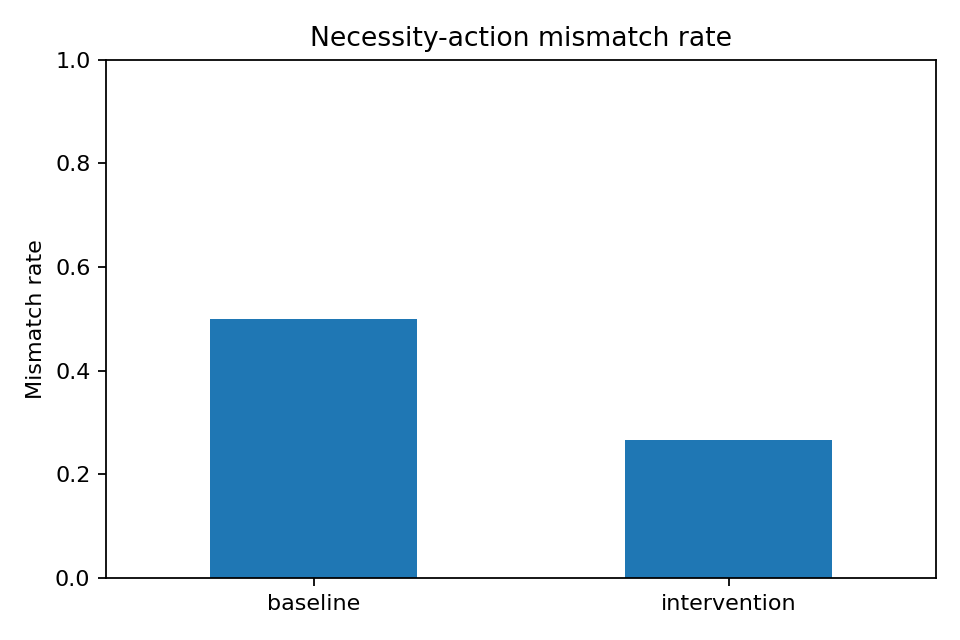

# The Knowing-Doing Gap: Does an LLM Know It Needs a Tool?

A behavioral probing experiment measuring the gap between what an LLM *believes* about its own capability and what it *does* when tools are available, replicated on **Qwen/Qwen2.5-7B-Instruct-Turbo** via TogetherAI.

Based on: Cheng, Fan, JafariRaviz, Rezaei, Feizi — ["Model-Adaptive Tool Necessity Reveals the Knowing-Doing Gap in LLM Tool Use"](https://arxiv.org/abs/2605.14038), 2026.

The experiment tests whether an LLM with access to tools can decide when to answer from memory and when to call a tool. It separates three signals for each question:

1. **Model-adaptive tool necessity**: whether Qwen2.5 can answer the question reliably without tools across repeated no-tool runs.
2. **Cognition**: whether the model reports low confidence answering without a tool.
3. **Action**: whether the model actually calls a calculator or search tool in an agentic setting.

Each question is mapped into one of four cells:

| Necessity      | Action            | Interpretation                    |
| -------------- | ----------------- | --------------------------------- |
| Needed tool    | Called tool       | Aligned behavior                  |
| No tool needed | Did not call tool | Aligned behavior                  |
| Needed tool    | Did not call tool | Tool underuse / knowing-doing gap |
| No tool needed | Called tool       | Tool over-reliance                |

## Results at a glance

| Metric                         | Baseline | Intervention |
| ------------------------------ | -------: | ------------: |
| Tool call rate                 |    93.3% |         56.7% |
| Necessity-action mismatch rate |    50.0% |         26.7% |
| Action accuracy                |    93.3% |         83.3% |

Qwen2.5-7B-Instruct calls a tool on 28 of 30 questions — including most of the ones it can already answer correctly on its own. That's the opposite failure mode from the paper's under-trained models (which *know* they need a tool but fail to call it): here the model **over-relies** on tools it doesn't need. A one-line system-prompt intervention ("use a tool only when not fully certain") nearly halves the mismatch rate, at the cost of two questions flipping into true tool-underuse. See [`results/summary_metrics.csv`](results/summary_metrics.csv) and the figures below for the full breakdown.

<p>
  
  
</p>

## Repository structure

```text
knowing-doing-gap/
  data/
    questions.json          # 30 curated questions: 15 arithmetic + 15 factual QA
    mock_search.json        # Mock search results for factual questions
  deliverables/
    question_set.xlsx       # Human-readable question-set table
  src/
    model_client.py         # TogetherAI OpenAI-compatible client
    label_necessity.py      # Repeated no-tool runs for model-adaptive necessity
    run_cognition.py        # Confidence-based cognition probe
    run_action.py           # Agentic tool-use action probe + intervention
    analyze_results.py      # Merge results, compute metrics, generate figures
    graders.py              # Lightweight answer grading helpers
    tools.py                # Calculator + mock search tools
    io_utils.py             # Shared JSON loading/writing helpers
  tests/
    test_graders.py         # Regression tests for answer grading
    test_tools.py           # Regression tests for the calculator/search tools
    test_run_action.py      # Regression tests for the tool-call JSON parser
  results/
    metadata.json
    questions_labeled.json
    summary_metrics.csv
    merged_results.csv
    four_cell_baseline.csv
    four_cell_intervention.csv
    figures/
      baseline_four_cell_outcomes.png
      baseline_mismatch_by_category.png
      intervention_four_cell_outcomes.png
      baseline_vs_intervention_mismatch.png
  run_experiment.sh         # End-to-end runner; writes to results/ by default
  requirements.txt
  .env.example
```

The included `results/` folder contains the review-ready outputs from the final Qwen2.5-7B-Instruct run. Large raw/intermediate model traces are intentionally excluded from the submitted package.

To preserve the included final results, run sanity checks into a separate folder such as `results_sanity/`.

## Setup

```bash
cd knowing-doing-gap
python3 -m venv .venv
source .venv/bin/activate
pip install -r requirements.txt
cp .env.example .env
```

Then edit `.env`:

```bash
TOGETHER_API_KEY=your_real_key
TOGETHER_MODEL=Qwen/Qwen2.5-7B-Instruct-Turbo
```

Do **not** commit `.env`.

## Running tests

The grading logic, tool executors, and the tool-call JSON parser have unit/regression tests (no API key required):

```bash
python3 -m pytest tests/
```

## Run the full experiment

The default runner writes directly to `results/`:

```bash
./run_experiment.sh
```

This runs:

```bash
python3 src/label_necessity.py --questions data/questions.json --outdir results --n 10 --temp 0.7
python3 src/run_cognition.py --questions results/questions_labeled.json --outdir results
python3 src/run_action.py --questions results/questions_labeled.json --outdir results
python3 src/run_action.py --questions results/questions_labeled.json --outdir results --intervention
python3 src/analyze_results.py --run-dir results
```

## Optional sanity checks

Run the first six questions into `results/`:

```bash
./run_experiment.sh results --limit 6
```

Or run a mixed subset by question ID:

```bash
./run_experiment.sh results --ids A01,A04,A08,A11,A14,F01,F04,F08,F12,F15
```

For a true sanity check, it is safer to change the output folder so the included final results are not overwritten:

```bash
./run_experiment.sh results_sanity --limit 6
```

## Final clean-run results

The included clean run used:

```text
Model: Qwen/Qwen2.5-7B-Instruct-Turbo
Provider: TogetherAI
Necessity labeling: N = 10 no-tool runs, temperature = 0.7
Question set: 30 total, 15 arithmetic + 15 factual QA
```

See [Results at a glance](#results-at-a-glance) above for the headline numbers. The full per-question breakdown is in [`results/merged_results.csv`](results/merged_results.csv), and the four-cell counts are in [`results/four_cell_baseline.csv`](results/four_cell_baseline.csv) / [`results/four_cell_intervention.csv`](results/four_cell_intervention.csv).

## Limitations

- **Grading is string-based**, not semantic: `graders.py` checks whether a normalized reference string appears in the model's answer. This is reliable for short numeric/factual answers but would need a more tolerant matcher (or an LLM judge) for open-ended questions.
- **Necessity is empirically estimated, not certain**: a question is labeled `tool_needed=True` if the model got even 1 of 10 no-tool runs wrong. A single unlucky sample at temperature 0.7 can flip a borderline question's label; increasing `--n` would tighten this at the cost of more API calls.
- **The search tool is mocked** (`data/mock_search.json`), so the action stage measures the *decision* to search, not whether a live search would have produced a useful result.
- **Single-model run**: the committed `results/` folder reflects one model (Qwen2.5-7B-Instruct-Turbo). Findings about over- vs under-reliance are specific to this model's instruction tuning and shouldn't be generalized without re-running the pipeline on other models.

## Notes

- The action stage uses a manual JSON tool protocol instead of native function calling. This makes the experiment more reliable for hosted open models that may not follow native tool-call formats consistently.
- The factual QA tool is a mock search tool, not a live web search API. This keeps the experiment reproducible.
- Re-running the pipeline will recreate intermediate files such as `action_baseline.json`, `action_intervention.json`, and `cognition.json` inside the selected output folder. These files are needed by the analysis script, but they are not included in the submitted `results/` folder because the final tables and figures are enough for review.

## License

[MIT](LICENSE)
